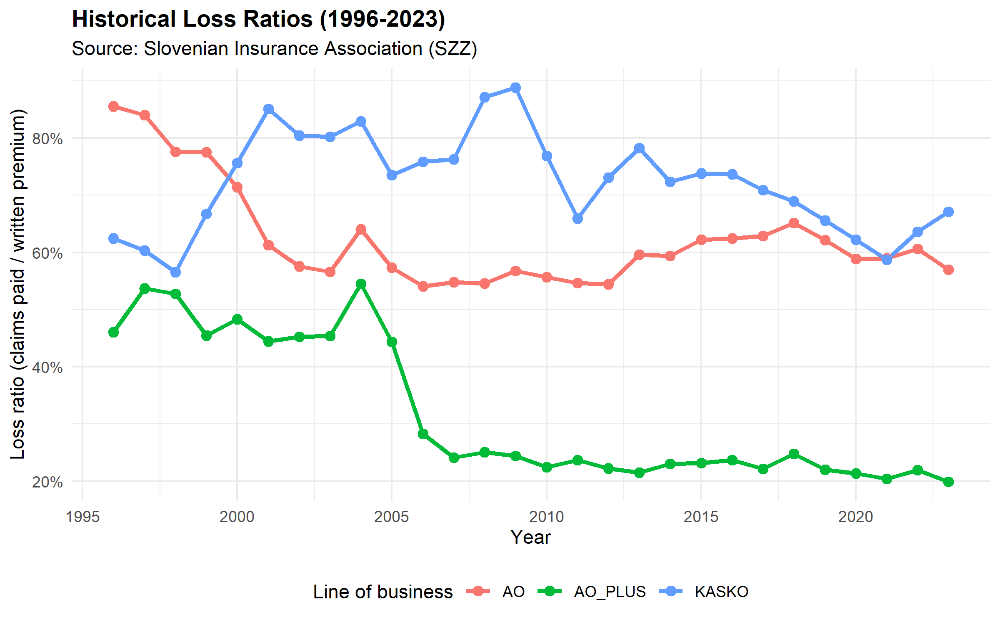

# Slovenian Motor Insurance: Premium Risk Model

How much will the Slovenian motor insurance market pay in claims next year, and how bad could a 1-in-200 year be?

This project answers that for the three main motor lines (MTPL/AO, AO+ and Kasko) using 28 years of public market data (1996–2023) from the Slovenian Insurance Association (SZZ). It projects 2026 claims, simulates 10,000 possible outcomes, and estimates the capital needed to survive a 1-in-200 bad year, which is the standard of Solvency II, the EU insurance capital rules.

**[Live demo](https://solvency-ii-motor-insurance-actuarial-reserve-model-2026-p5en7.streamlit.app/)**

---

## Key findings

| | 2026 projection |
|---|---|
| Expected market claims | **€551M** |
| Capital for a 1-in-200 year | **€96M** (17.5% of expected claims) |
| Capital if the trends were known exactly | €53M (9.7%) |

1. **Uncertainty about the trends themselves is almost half of the capital.** The trends are fitted on 2011–2023 only (see finding 5), and allowing for the fact that they are estimates raises capital from €53M to €96M.
2. **Kasko claims rise about 3.1% a year faster than general prices** (±0.4%). This is consistent with spare-part prices, which SZZ reports rose more than 50% in five years.
3. **MTPL (AO) shows no claims inflation above general prices** (−0.5% ± 0.5% a year).
4. **In AO and AO+, the number of claims and the average claim move in opposite directions** (correlation −0.82 and −0.73): years with fewer claims have larger average payments. Ignoring this would raise the capital estimate from €96M to €123M.
5. **The market changed regime before 2011, so the trends start there.** Kasko take-up grew strongly until about 2010, AO+ changed as a product around 2005–06, and real claim sizes fell for 15 years before rising again. One line through all 28 years fits the data badly (volatility up to seven times higher), so the earlier years are used to explain the history, not to extrapolate.

---

## Scope

This is a **market-level premium risk study**, not an insurer's Solvency II balance sheet.

* "Expected claims" are claims expected to be **paid** in 2026 (SZZ's *obračunane odškodnine*: amounts booked in the calendar year, without reserves). They are not a Best Estimate Liability, which is a discounted provision for claims already incurred.
* Claims-handling costs are excluded, as in the SZZ data.
* The capital covers **premium risk** only: next year's claims being higher than expected. It excludes reserve, market, counterparty and operational risk.
* The data are annual market totals. Individual claims and claim development (run-off triangles) are not public.

---

## Data

| Source | What | Years used |
|---|---|---|
| SZZ, *Zavarovanja motornih vozil* | Policies, claims, premium, claims paid per line | 1996–2023 |
| SURS (SiStat) | Registered passenger cars at 31 December, physical and legal persons | 1996–2023 |
| Eurostat HICP via FRED (`CP0000SIM086NEST`) | Slovenian consumer prices, annual average, 2025 = 1 | 1996–2025 |

Pre-2007 amounts are in euros converted by SZZ at 239.64 SIT/EUR.

**Three data decisions:**

* **The data stop at 2023.** SZZ figures cover members' business in Slovenia *and abroad*. From 2024 they include large foreign motor business, mainly Triglav's entry into the Italian motor market in mid-2025, which added about €600M of AO premium. 2023 is confirmed Slovenia-only: total AO premium per resident (€165.9) matches SZZ's Slovenia-only figure (€166). 2024–2025 stay in the data file but are not used.
* **Kasko frequency is measured per registered car, not per policy.** SZZ notes that Kasko policy counts are unreliable: one policy can cover several vehicles, some insurers count partial Kasko, and counts before 2004 are not comparable. Switching to registered cars cut the volatility of Kasko frequency by about two thirds.
* **Trends start in 2011 for all lines** (finding 5). The COVID years 2020–21 are excluded from the frequency trends only, because lockdowns would pull the forecast down; including them would lower expected claims to €522M with almost the same capital ratio.

---

## Method

Total claims for each line are split into parts that can be modelled separately:

**claims = exposure × claim frequency × average claim size**

| Component | How it is modelled | Why |
|---|---|---|
| Exposure | Policies (AO, AO+) or registered cars (Kasko), trend of the last 5 years | The market keeps growing |
| Claim frequency | Log-linear trend with year-to-year variation, then Poisson noise | Real claim counts vary far more than plain Poisson allows |
| Average claim size | Log-linear trend of **real** (inflation-adjusted) severity | Separates claims inflation above prices (*superimposed inflation*) from general inflation |
| General inflation | Explicit assumption: 2.5% for 2026 | Visible and adjustable instead of hidden in the trend |
| Frequency–severity link | Correlation estimated from the trend residuals | Avoids double-counting volatility (finding 4) |
| Parameter uncertainty | Each simulation draws its own trend and volatility from their estimated distribution | 13 years of data leave the trends uncertain; a test confirms the forecast intervals have the stated coverage |

**Capital = 99.5th percentile of simulated claims − expected claims.**
Expected claim sizes use the lognormal mean exp(μ + σ²/2), not the median exp(μ).

---

## Results by line

| Line | Expected 2026 | Capital (trends known) | Capital (trends uncertain) | Paid loss ratio 1996–2023* |
|---|---|---|---|---|
| MTPL (AO) | €232M | €25M | €71M | 60.0% |
| AO+ | €6M | €1M | €3M | 29.8% |
| Kasko | €313M | €49M | €76M | 71.3% |
| **Portfolio** | **€551M** | **€53M** | **€96M** | |

\*Premium-weighted: total claims paid ÷ total written premium. The simple average of yearly ratios is higher on every line (AO 62.4%), because the small early years had high loss ratios.

The portfolio needs less capital than the three lines separately (€96M against €150M), because bad years in one line are partly offset by normal years in the others. The lines are simulated independently, which overstates this benefit; see *Next steps*.

### Historical loss ratios (independent R check)


---

## Validation

* **Data checks** before the database is built: missing years, duplicates, non-numeric or non-positive values, implausible ratios and large year-on-year jumps. These caught two transcription errors in the 1996–2015 data.
* **Unit tests** (`tests/test_model.py`): the trend fit recovers known growth rates and breaks; simulated means match the closed-form formula; 95% forecast intervals contain the true value about 95% of the time; inflation is applied from the right base year.
* **Structural-break tests** (`explore_breaks.py`): F-tests with a Bonferroni correction, on all years and on the trend window. No break inside 2011–2023 passes on Kasko or AO+. AO shows a post-COVID shift (fewer, larger claims) in 2020, but total cost per policy shows no jump and there are only 2–4 later years, so it is not modelled.
* **Distribution checks:** lognormal and gamma fit equally well (AIC within 0.2), and Shapiro–Wilk does not reject normality of the log-residuals on any line (p = 0.07–0.83).
* **Cross-language check:** an R script recomputes the loss ratios and trends directly from the database and matches the Python results.

---

## Limitations

* **Three-year projection.** The last usable year is 2023, so 2026 is three years ahead, while Solvency II looks one year ahead. This widens the parameter uncertainty.
* **Calendar-year paid amounts.** The model projects claims paid in 2026, including payments on earlier accidents, not the full cost of 2026 accidents. This probably explains part of the negative frequency–severity correlation in the long-tailed AO line.
* **Regime changes.** The model assumes 2026 belongs to the same regime as 2011–2023. A new law or product change is not in the 99.5% estimate.
* **Exposure growth.** AO policies grew about 4.5% a year in 2019–2023, against 1.4% for registered cars. If they grew only at the vehicle rate, AO expected claims would be about €219M instead of €232M.
* **2023 was a heavy year.** The August 2023 floods raised Kasko and AO claims. The model treats this as ordinary year-to-year variation.
* **Lines are independent** in the simulation.
* **The correlation is estimated from 11 years** and is itself uncertain.

## Next steps

1. **Backtesting:** forecast each year using only earlier data and check how often actual claims fell outside the predicted range. This also tests the 2011 start year out of sample.
2. **Comparison with the Solvency II standard formula** premium-risk parameters for motor.
3. **Dependence between lines** (Gaussian and Student-t copulas).
4. **Stress scenarios:** inflation shocks, a regime change like AO+ in 2005–06, and a catastrophe year like 2023.
5. **Slovenia-only data for 2024 onwards**, if SZZ publishes it separately.

---

## What changed in version 2

* **Terminology corrected:** "BEL" and "SCR" are now expected next-year claims and premium-risk capital.
* **Data extended** from 10 to 28 years, with foreign business excluded and transcription errors fixed.
* **Inflation split** into general (CPI) and claims-specific inflation.
* **Kasko exposure** changed from SZZ policies to registered cars.
* **Trend windows** chosen from structural-break tests.
* **Claim frequency** has its own trend and realistic variation; plain Poisson made frequency risk almost zero.
* **Parameter uncertainty** and **frequency–severity correlation** added.
* **Loss ratios premium-weighted.**
* **Assumptions centralised** in `config.py`, plus data validation, unit tests and break tests.
* **Individual-claim simulation dropped from the plan:** with aggregate data it would understate the risk.

---

## Repository structure

```text
.
├── data/
│   ├── szz_claims_raw.csv          # SZZ market data, 1996–2025 (model uses to 2023)
│   ├── registered_cars.csv         # SURS registered passenger cars, 1996–2025
│   └── hicp_slovenia_monthly.csv   # Slovenian consumer price index (HICP)
├── config.py               # All model assumptions and data decisions
├── database_setup.py       # Validates the data and builds szz_market.db
├── model_engine.py         # Trends, projection, Monte Carlo simulation, diagnostics
├── explore_breaks.py       # Structural-break tests and charts
├── app.py                  # Streamlit dashboard
├── scripts/
│   └── analysis_module.R   # Independent R check of loss ratios and trends
├── tests/
│   └── test_model.py       # Tests of the model's maths
├── requirements.txt
└── README.md
```

## How to run

```bash
git clone https://github.com/klepecvabicrok/Solvency-II-Motor-insurance-Actuarial-Reserve-Model-2026.git
cd Solvency-II-Motor-insurance-Actuarial-Reserve-Model-2026
pip install -r requirements.txt

python database_setup.py          # validate data, build the database
python explore_breaks.py          # break tests, writes breaks_<LINE>.png
python model_engine.py            # trends and capital results
pytest                            # run the tests
streamlit run app.py              # dashboard
Rscript scripts/analysis_module.R # R check, writes loss_ratio_trend_R.png
```

Tools: Python (NumPy, pandas, SciPy, Matplotlib), SQLite, Streamlit, Plotly, R (dplyr, ggplot2).

## Sources

* SZZ – Slovensko zavarovalno združenje, *Zavarovanja motornih vozil* (editions covering 2023 and 2025).
* SURS, SiStat: registered road vehicles at 31 December.
* Eurostat HICP for Slovenia via FRED, series [CP0000SIM086NEST](https://fred.stlouisfed.org/data/CP0000SIM086NEST).
* Business Insurance, ["Triglav's premiums jump 53%"](https://www.businessinsurance.com/triglavs-premiums-jump-53/), 20 March 2026.
